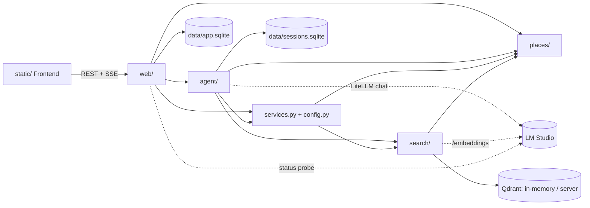
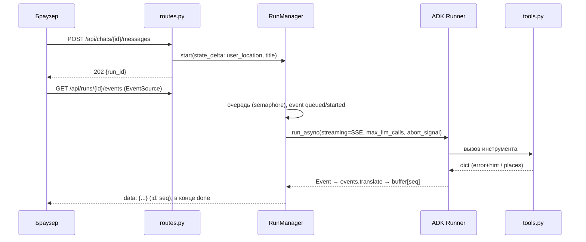

> generated_by: nexus-mapper v2
> verified_at: 2026-10-22
> provenance: AST-backed (Python + JavaScript, 41 files, 0 parse errors) for module/class/function inventory; internal import edges are from manual inspection (grep of `from .`/`from ..` and JS `import`) because the AST extractor does not resolve Python relative imports; hotspots skipped: no git metadata.

# Зависимости

> Все стрелки ниже — `inferred from manual inspection` (grep импортов): AST-экстрактор не разрешает относительные импорты Python. Циклов между системами не найдено.

## Входящие импорты (ручной подсчёт)

| Модуль | Кем импортируется |
|---|---|
| `places/repository.py` | search/documents, search/store, search/evaluate, agent/tools, agent/evaluate, services, web/events, web/runs |
| `services.py` | agent/factory, agent/tools, agent/evaluate, web/app, `__init__` |
| `places/hours.py` | places/repository, agent/tools, agent/prompt, web/events, web/routes |
| `places/kinds.py` | places/repository, search/documents, agent/tools, web/events |
| `config.py` | services, agent/factory, web/app, web/runs, `__init__` |
| `agent/tools.py` | agent/factory, agent/prompt, web/routes (`USER_LOCATION_KEY`) |
| `agent/factory.py` | agent/evaluate, web/app, web/routes (`APP_NAME`) |
| `web/events.py` | web/runs, web/routes |

Frontend: `app.js` → `api.js`, `chat.js`, `map.js`, `ui.js`; `chat.js` → `markdown.js`, `ui.js`; `map.js` → `ui.js` (AST-backed, JS).

## Последовательность вопроса

## Хрупкие стыки
- `web/routes.py` ↔ `agent/tools.py`: общий ключ состояния `user_location`.
- `web/events.py` ↔ `static/js/chat.js`: формат событий UI (ручной контракт, без схемы).
- `agent/tools.py` → `search/sparse.py` (`meaningful_terms`): агент зависит от токенизации поиска.
