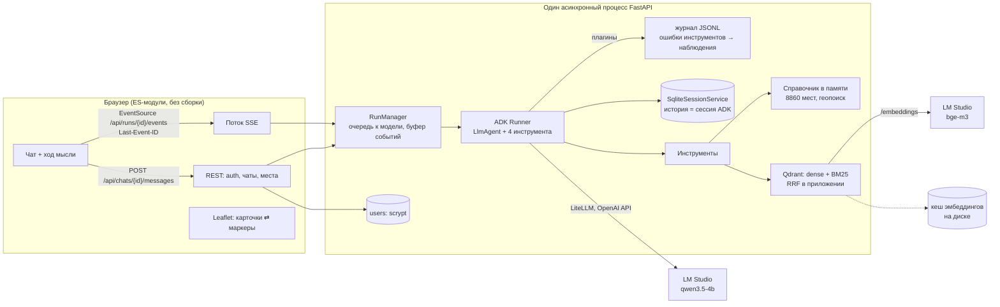

# Архитектура «Ростов-гида»

Агент-справочник по 8860 местам Ростова-на-Дону (снимок OpenStreetMap). Пользователь пишет вопрос словами —
«забыл, как называется кафе, там были пельмени» — и видит, как агент рассуждает, какие инструменты зовёт
и что они вернули; найденные места появляются карточками и на карте.

## Схема

## Ход одного вопроса

1. `POST /messages` проверяет владельца чата, кладёт в `state_delta` точку пользователя на карте и
   заголовок чата, создаёт **прогон** и сразу отвечает `202 {run_id}` — запрос не ждёт модель.
2. Прогон встаёт в очередь (`MAX_PARALLEL_RUNS` одновременно); ожидающие получают событие
   `queued` со своей позицией.
3. Фоновая задача крутит `Runner.run_async(streaming_mode=SSE)`. Каждое событие ADK переводится
   (`web/events.py`) в события интерфейса: `thought_delta`, `tool_call`, `tool_result` (с карточками мест
   и координатами), `answer_delta`, `usage` — и складывается в буфер с порядковыми номерами.
4. Браузер читает буфер через `EventSource`. Обрыв связи или перезагрузка страницы — браузер
   переподключается с `Last-Event-ID`, сервер досылает пропущенное. Когда всё доставлено,
   сервер отвечает `204`, и `EventSource` перестаёт переподключаться.
5. ADK сам пишет события в сессию; история чата строится из неё тем же переводчиком событий,
   поэтому ход мысли после перезагрузки выглядит так же, как вживую.

## Решения и почему так

### 1. Google ADK поверх локальной модели через LiteLLM
`LlmAgent` + `Runner` дают то, что в задании 1 пришлось бы писать руками: цикл с лимитом шагов
(`RunConfig.max_llm_calls`), сессии, стриминг, плагины, отмену (`abort_signal`). Модель подключена
через `LiteLlm("openai/…")` к OpenAI-совместимому серверу: по умолчанию LM Studio с `qwen3.5-4b`,
облако — сменой трёх переменных в `.env`. Рассуждение модели (`reasoning`) ADK превращает в части
с `thought=True` — именно их пользователь видит как «ход мысли».

### 2. Прогон отделён от HTTP-соединения
Вопрос — фоновая задача с буфером событий, а не обработчик, держащий соединение. Отсюда:
переподключение без потерь, ответ дописывается и сохраняется, даже если вкладку закрыли,
кнопка «Стоп» (`POST /runs/{id}/cancel` → `abort_signal` ADK), таймаут прогона.
`EventSource` выбран вместо `fetch`-стрима именно из-за встроенного переподключения с `Last-Event-ID`.

### 3. Многопользовательский режим упирается в модель, а не в сервер
Сервер асинхронный от и до: `aiosqlite`, асинхронный клиент Qdrant, `httpx`, LiteLLM; медленный
scrypt — в пуле потоков. Узкое место — одна видеокарта, поэтому перед моделью стоит очередь
с видимой позицией, лимиты «один прогон на чат» и «два на пользователя», потолок очереди
(`409` вместо бесконечного ожидания). Это проверено тестами (`tests/test_runs.py`) и вживую:
пока соседний процесс занимал LM Studio, интерфейс показывал ожидание и таймер, а не зависание.

### 4. Авторизация и изоляция
Пароль — `scrypt` с солью (стандартная библиотека), JWT — в cookie `HttpOnly; SameSite=Lax`, JS токена
не видит. Изменяющие запросы с чужим `Origin` отклоняются, попытки входа ограничены по адресу,
на «нет такого пользователя» тратится то же время, что на «не тот пароль».
`user_id` из токена — это `user_id` сессии ADK: чужой чат нельзя даже найти (`404`, а не `403`).

### 5. Учёт контекста
- **Память диалога** — сессии ADK в SQLite: «а до скольки работает второе?» агент разрешает по id мест
  из прошлых результатов инструментов (они в истории).
- **Окно модели** — LM Studio держит `qwen3.5-4b` с окном 16k. `EventsCompactionConfig` сворачивает
  старые события в сводку, когда промпт перерастает `CONTEXT_COMPACT_TOKENS`; последние события
  остаются как есть. Сводку пишет та же модель по русскому шаблону, который требует сохранить id мест —
  иначе после сжатия «второе» стало бы не к чему привязать. Рассуждение у суммаризатора выключено
  (`reasoning_effort=none`): с ним одно сжатие стоило до минуты, без него — секунды.
- **Сжатие не должно съедать вопрос.** ADK сжимает историю и посреди прогона, перед вызовом модели;
  тогда в сводку уходит и текущий вопрос, а остаются только вызовы инструментов. Шаблон чата Qwen
  на таком запросе падает. Плагин `UserTurnGuard` возвращает вопрос в запрос, если его там не осталось.
- **Видимость** — индикатор «Контекст 3,0k / 16k» в шапке чата; сжатие показывается в ленте.
- **Контекст хода** — точка на карте и текущее время в Ростове попадают в инструкцию агента
  (`InstructionProvider`), точка ещё и в состояние сессии, откуда её читают инструменты.

### 6. Поиск по смыслу: гибрид в Qdrant
Название места часто ничего не говорит о нём, а у большинства мест в OSM есть только название и тег.
Поэтому:
- **Расширение документа словарём.** Тег кухни `russian` → «русская кухня: пельмени, борщ, блины»,
  вид `atm` → «снять наличные». Это не показывается пользователю как факт, только помогает поиску.
- **Плотные векторы** (`bge-m3` в LM Studio — лучший мультиязычный в эксперименте E1 соседнего
  проекта) ловят смысл: «Хинкальная» по «пельмени».
- **BM25** (snowball-стемминг, IDF считает Qdrant) ловит точные слова и формы: «пельмени» ↔ «Пельмень».
  Слова намерения («забыл», «название», «ресторан») из лексического запроса выкидываются.
- **RRF** — в приложении, а не в Qdrant: у каждого результата видно, кто его нашёл
  («по смыслу», «по словам», «смысл + слова»), и это видно пользователю на карточке.

Оценка на 20 размеченных запросах (`uv run rostov-guide eval-search`, разметка правилами — нижняя
оценка):

| Режим | P@5 | Hit@1 |
|---|---|---|
| только смысл (bge-m3) | 0.85 | 0.90 |
| только слова (BM25) | 0.87 | 1.00 |
| **гибрид (RRF)** | **0.92** | **0.95** |

До словаря потребностей видов гибрид давал P@5 0.76 — расширение документа дало больше, чем выбор
модели эмбеддингов.

### 7. Где живёт индекс
Встроенный Qdrant на диске под Windows пишет ~37 мс на точку и при этом **блокирует цикл событий**
(замерено: 1024 точки — 38 с). В памяти — 0,5 с. Поэтому без сервера коллекция живёт в памяти,
а долговечное хранилище — дисковый кеш эмбеддингов (ключ — модель + текст): LM Studio считает ~40
документов в секунду, и пересчитывать 8860 мест на каждом старте нельзя. Первый запуск — ~4 минуты
на эмбеддинги, каждый следующий — 7 секунд на загрузку из кеша. С `QDRANT_URL` тот же код работает
с сервером Qdrant (`docker-compose.yml`), коллекция переживает перезапуски.

Сборка идёт **в фоне**: сервер отвечает сразу, интерфейс показывает прогресс, агент до готовности
получает от `search_places` подсказку «пользуйся фильтрами». Пересборка — без простоя: новая
коллекция строится под своим именем и подменяет старую атомарной записью `index_meta.json`.

### 8. Инструменты под маленькую модель
4B-модель путается в больших схемах, поэтому инструментов четыре, аргументы плоские со значениями
по умолчанию, в описании — когда звать и когда НЕ звать, с примером. `kind` принимается и как
`pharmacy`, и как «аптеки». Ошибка ввода возвращается как `{"error", "hint"}` с подсказкой — модель
исправляет вызов сама; упавший инструмент плагин превращает в такое же наблюдение. Повторный вызов
с теми же аргументами в одном прогоне не выполняется (`RepeatGuard`): модель получает «результат уже
выше» — так лечится зацикливание, а не только упирается в лимит шагов. Результат сжат:
до 10 мест и без координат — карточки с координатами для карты интерфейс берёт из справочника по id.
Отсутствующие адрес и часы не выбрасываются, а помечаются «нет в базе»: модель должна отличать
«данных нет» от «не запросил» (см. «Что нашла перепроверка»).

### 9. Справочник в памяти
База только читается и весит 2 МБ: при старте она целиком поднимается в память (асинхронно),
фильтры и геопоиск по списку занимают микросекунды. Геокодера нет, но есть 8860 адресов: дом по улице
и номеру → середина улицы → место с таким названием («Центральный рынок»).

### 10. Фронтенд без сборки
ES-модули отдаёт тот же FastAPI: одна команда запуска, нет `node_modules`. Markdown рендерится
своим маленьким рендером, который сначала экранирует весь текст — данные OSM и ответ модели не могут
внедрить HTML. Карта на Leaflet с тайлами самого OSM; номера маркеров совпадают с номерами карточек,
названия в ответе кликабельны.

### 11. Наблюдаемость
Плагин ADK пишет каждый шаг в `runs/agent-YYYY-MM-DD.jsonl`: вопрос, вызовы модели с токенами
и задержкой, вызовы инструментов с аргументами и сжатым результатом. В интерфейсе под каждым ответом —
модель, токены, время.

## Как проверено

- `uv run pytest` — 62 теста без сети и без модели: часы работы, геокодинг, BM25, индекс в Qdrant
  с фейковыми эмбеддингами, инструменты (ошибки как наблюдения), плагины, перевод событий ADK,
  очередь и переподключение прогонов, API целиком (вход, изоляция пользователей, CSRF, SSE, история).
- `uv run rostov-guide eval-search` — таблица выше.
- `uv run rostov-guide eval-agent -n 3` на `qwen3.5-4b`: 9 сценариев × 3 повтора, пройдено 27 из 27
  (нижняя граница Уилсона 0.88), в среднем 10,8 с и 2,56 шага модели на сценарий. До исправлений
  из раздела ниже тот же набор давал 8 из 9.
- Вручную в браузере: регистрация и вход, живой ход мысли, уточнение по памяти, точка на карте
  и «рядом со мной», очередь при занятой модели, перезагрузка страницы посреди ожидания, тёмная
  и светлая тема, узкий экран.

## Что нашла перепроверка

Последний сквозной прогон диалога «Сколько круглосуточных аптек?» → «А какая из них ближе всего
к Белорусской, 44?» упал, и разбор (журнал JSONL + сверка ответа с базой) нашёл дефекты, которых
не было видно ни в тестах, ни в оценке на одиночных вопросах:

1. **Зацикливание.** У `nearest_places` не было фильтра «круглосуточно», и модель пять раз подряд звала
   его с одинаковыми аргументами. Исправлено: фильтр `only_24_7` и плагин `RepeatGuard`.
2. **Сжатие контекста ломало запрос.** На ~7k токенов сработало сжатие посреди прогона, вопрос ушёл
   в сводку, LM Studio ответил `No user query found in messages`. Исправлено: `UserTurnGuard`, порог
   поднят до 10k при окне 16k, сводка без рассуждения. Проверено с искусственным порогом 2,5k:
   три сжатия за диалог, ответ получен.
3. **Неверный ответ.** Когда модель передавала и вид, и запрос («аптека» + «круглосуточная аптека»),
   ближайшее искалось среди 30 смысловых совпадений, и настоящая ближайшая (781 м) туда не попадала —
   агент уверенно называл аптеку в 2,6 км. Исправлено: если запрос не добавляет смысла сверх вида
   и фильтров, ищем по всем местам вида. Сценарий добавлен в `eval-agent`, случай — в тесты.
4. **Поиск несуществующего.** У многих мест в OSM нет адреса или часов. Инструмент просто не включал
   пустое поле, и модель читала это как «не запросил»: шла искать адрес банкомата другими
   инструментами, пока не кончался лимит шагов. Теперь в ответе всегда есть `"address": "нет в базе"`,
   а в инструкции — «такое поле не ищи, скажи пользователю». Найдено по журналу JSONL.

## Ограничения и что дальше

- `RunManager` и очередь живут в памяти одного процесса. Для нескольких процессов — буфер событий
  в Redis Streams (тот же протокол с `Last-Event-ID`) и сессии в Postgres (`DatabaseSessionService`).
- Очередь общая (FIFO); справедливое деление между пользователями — следующий шаг.
- Тайлы `tile.openstreetmap.org` годятся для учебного MVP; под нагрузкой нужен свой тайл-сервер.
- Данные — снимок OSM: часы и адреса заполнены не у всех мест, агент честно пишет «не указано».
